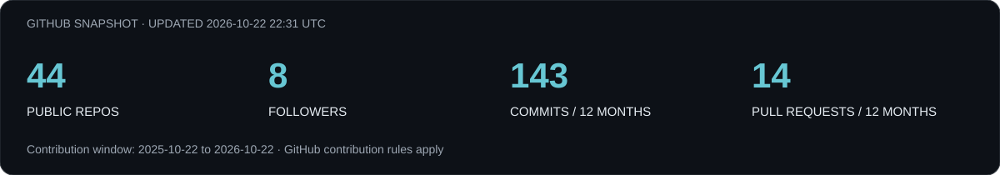

<picture>
  <source media="(max-width: 600px)" srcset="assets/profile-banner-mobile.svg">
  
</picture>

<picture>
  <source media="(prefers-color-scheme: dark)" srcset="https://readme-typing-svg.demolab.com?font=Fira+Code&amp;size=20&amp;duration=3200&amp;pause=1600&amp;color=67C7D4&amp;width=680&amp;height=40&amp;lines=Designing+clear+APIs;Connecting+services+with+messaging;Building+testable+backends">
  
</picture>

  <a href="#user-content-introduction">Introduction</a> &nbsp; / &nbsp;
  <a href="#user-content-selected-projects">Projects</a> &nbsp; / &nbsp;
  <a href="#user-content-tech-stack">Tech stack</a> &nbsp; / &nbsp;
  <a href="#user-content-github-dashboard">GitHub dashboard</a> &nbsp; / &nbsp;
  <a href="#user-content-connect">Connect</a>

## Introduction

I'm **Doan Trung Kien**, a **Java Backend Engineer** based in Vietnam. I build backend services and asynchronous workflows, with a focus on maintainable code, reliable APIs, and performance.

I work with Java, Spring Boot, and Vert.x, verify behavior through automated tests, and optimize services with Redis caching and SQL query tuning. My interests include **distributed systems and event-driven architecture**.

## Selected projects

### [ssoauthserver](https://github.com/dtkien-dev/ssoauthserver)

An authentication project that exchanges login credentials for a signed JWT. The code demonstrates Spring Security authentication and JWT generation, parsing, and validation.

**Java 21 · Spring Boot · Spring Security · JWT**

[Explore the login flow](https://github.com/dtkien-dev/ssoauthserver/tree/HEAD/src/main/java/com/dtk/ssoauthserver/app)

### [agent-skills](https://github.com/dtkien-dev/agent-skills)

A portable collection of skills for Codex, Claude Code, and Kiro. Shared workflow guides and installation helpers make the collection reusable across agent environments.

**Agent workflows · Markdown · Shell · PowerShell**

[Read the workflow guide](https://github.com/dtkien-dev/agent-skills/blob/HEAD/docs/skills-workflow.md)

[Browse all repositories →](https://github.com/dtkien-dev?tab=repositories)

## Tech stack

**Backend**

**Data & messaging**

**Delivery & testing**

Full stack & engineering practices

| Area | Technologies & tools |
| :--- | :--- |
| **Languages** | Java 21 · Go |
| **Backend & frameworks** | Spring Boot · Spring Data · Vert.x · Jmix · Backbase |
| **APIs & identity** | REST APIs · OpenAPI · Keycloak |
| **Testing** | JUnit · Mockito · Integration tests |
| **Data & caching** | PostgreSQL · MySQL · Redis · Elasticsearch |
| **Messaging & discovery** | RabbitMQ · Apache Kafka · ActiveMQ · Eureka |
| **Build & delivery** | Maven · Git · GitLab · GitFlow · Jenkins · Argo CD |
| **Containers & operations** | Kubernetes · Rancher · k9s · Docker (Basic) |
| **Observability & engineering insights** | Grafana · LinearB |
| **AI-assisted development** | OpenAI Codex · Claude Code · Kiro · Prompt Engineering |

**Engineering practices:** Clean Architecture, SOLID principles, asynchronous processing, caching strategies, SQL pagination and query tuning, production troubleshooting, and log analysis.

## GitHub dashboard

<picture>
  <source media="(max-width: 600px)" srcset="assets/github-stats-mobile.svg">
  
</picture>

Updated hourly · Timestamp in UTC · Commits and pull requests cover the last 12 months. GitHub scheduling and caching may delay updates.

Play the contribution snake

<picture>
  <source media="(prefers-color-scheme: dark)" srcset="assets/github-snake-dark.svg">
  
</picture>

Generated hourly with [Platane/snk](https://github.com/Platane/snk). Close this section to hide the animation.

[View activity on GitHub →](https://github.com/dtkien-dev?tab=overview)

## Connect

Open to collaboration, project discussions, and exchanging technical ideas.

**[LinkedIn](https://www.linkedin.com/in/doantrungkien10082002/)** &nbsp; / &nbsp; **[GitHub](https://github.com/dtkien-dev)** &nbsp; / &nbsp; **[Email](mailto:doantrungkien10082002@gmail.com)**

Typing animation by <a href="https://github.com/DenverCoder1/readme-typing-svg">Readme Typing SVG</a>.
